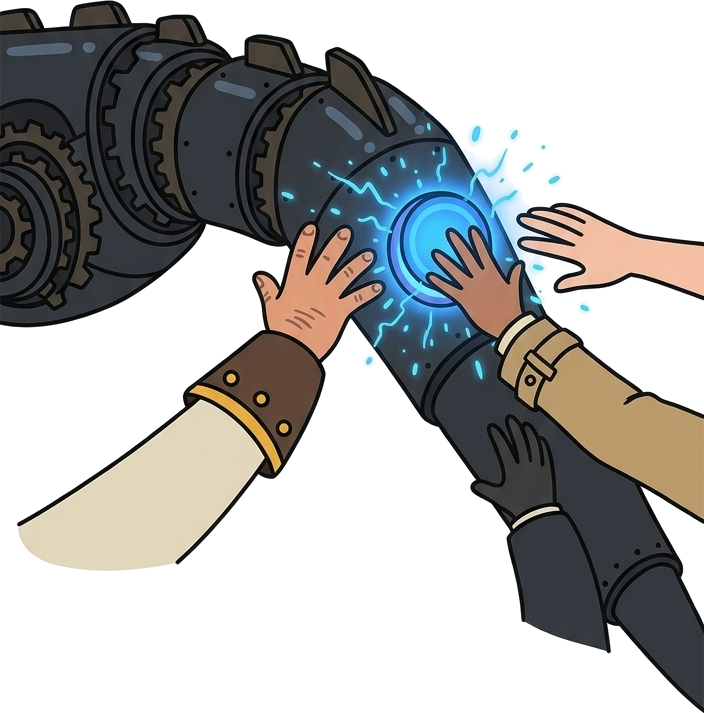
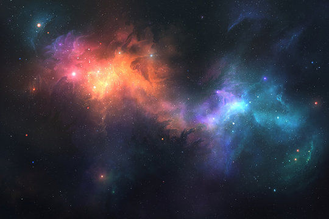

# Group 11
# Team Story Challenge

This is the starting draft of your team’s story.  
Your mission: **revise and improve it**, making it coherent, funny, and illustrated with the provided images.

---

## Our Wonderful Story

1. Once upon a time, there was a castle on a hill, where a young scientist named Mira lived with her cat, Pixel.

 

2. Then suddenly, a dragon appeared in the sky. But when it landed, everyone saw gears and blinking lights. It was a robot dragon that Mira had secretly built.

3. Mira shouted, “The key to the treasure is hidden inside the dragon’s tail!” Everyone rushed over, and the villagers, a pirate named Captain Redbeard, and a detective named Sam all pressed the glowing button on its tail.

4. After that, everyone was teleported into a dark cave. Nobody knew exactly how they got there, but in the middle of the cave sat a treasure chest.

 

5. Inside the chest was a map,but it had no directions, only a picture of stars. Mira realized it was a star map and could only be read from space.

 

6. “Let’s go to space!” shouted Captain Redbeard, who had been quietly following the group since the castle. 

7. A rocket blasted off from the cave, and at the same moment Mira’s time machine broke down, because the rocket drained all of its power. 

8. Pixel the cat jumped onto the map and said, “Follow the third star on the left. It points to the Whispering Forest.”  

9.  In the forest, Detective Sam discovered a golden key buried under an old tree, the very key the map was hiding. 

10. The key opened the chest’s secret compartment, which held a new battery for the time machine. Mira repaired it, and everyone traveled home to the castle. From then on, the robot dragon guarded the hill, and Pixel became the most famous talking cat in the kingdom. The end.

